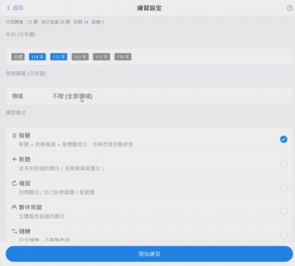
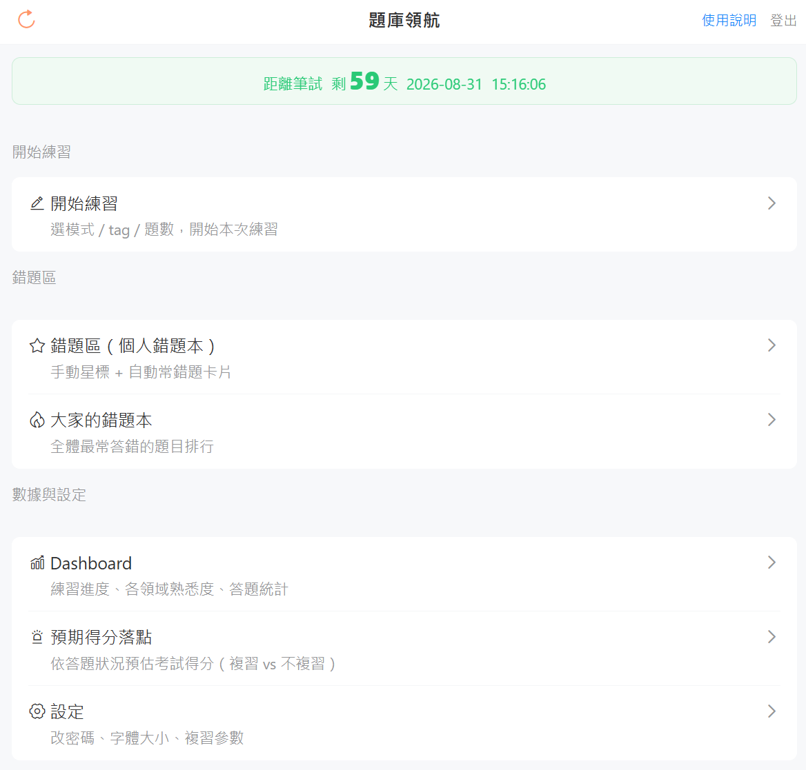
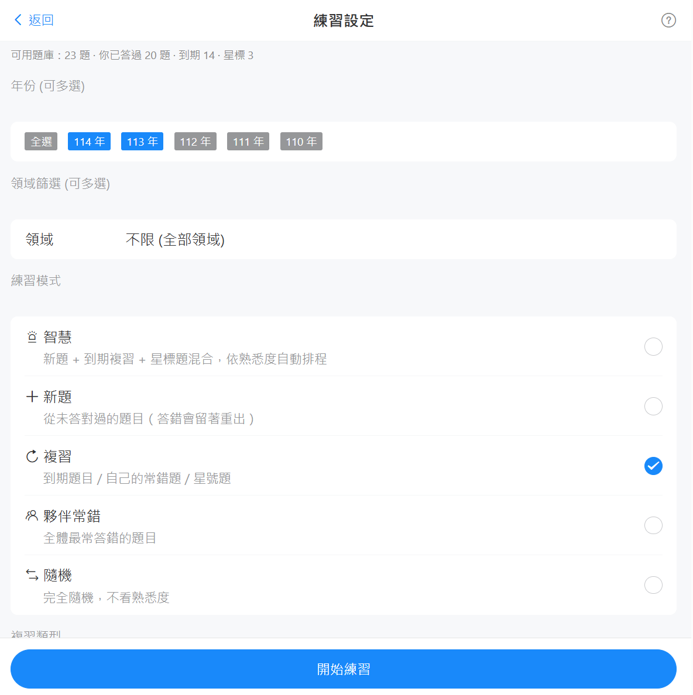
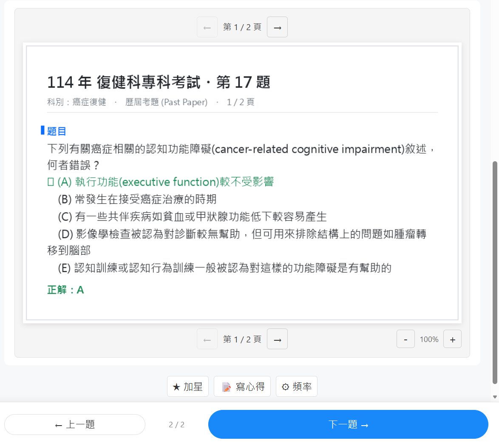
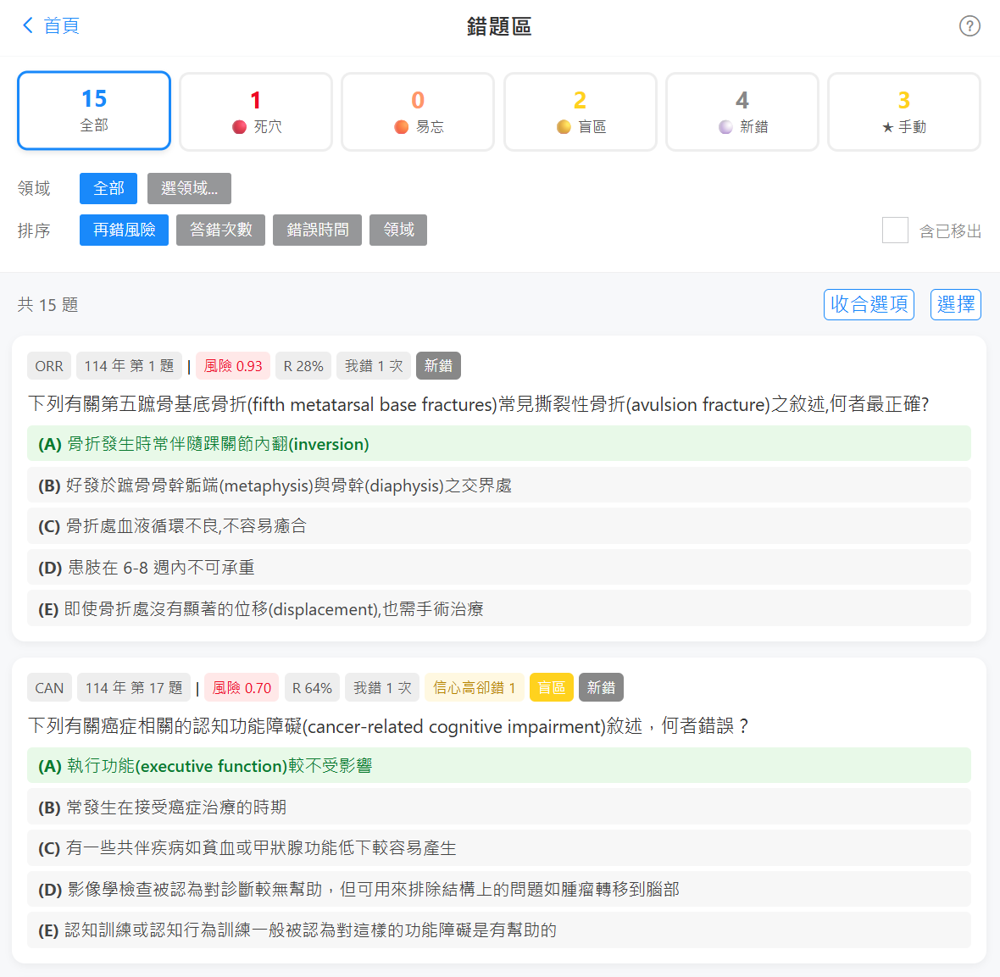
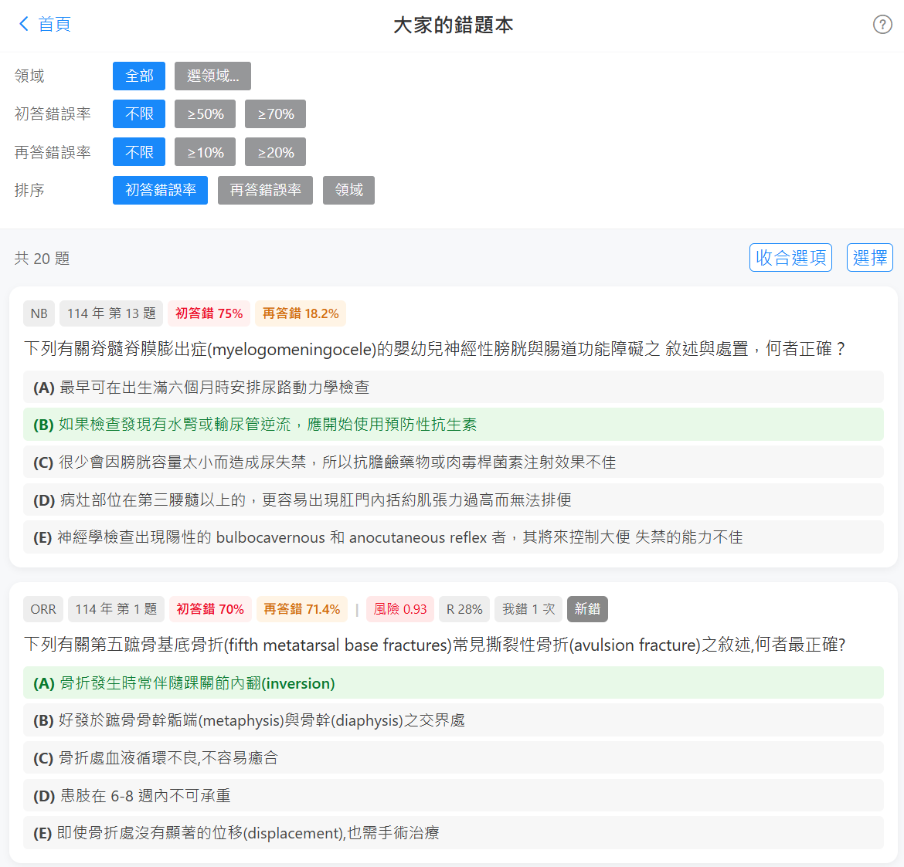
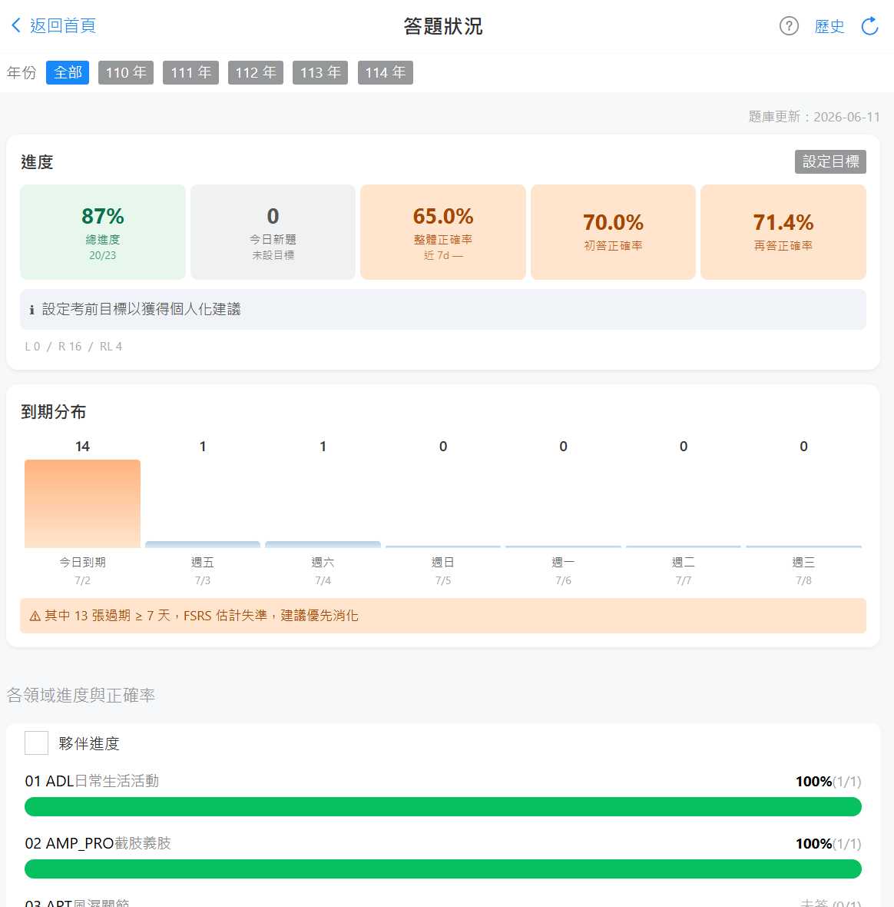
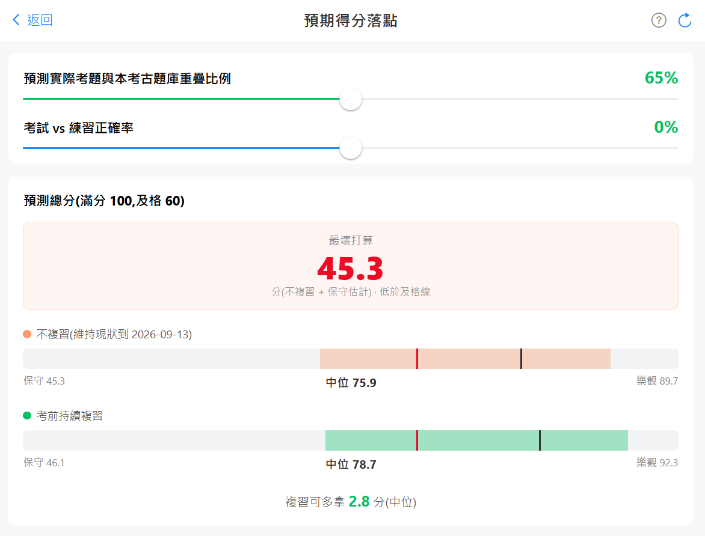
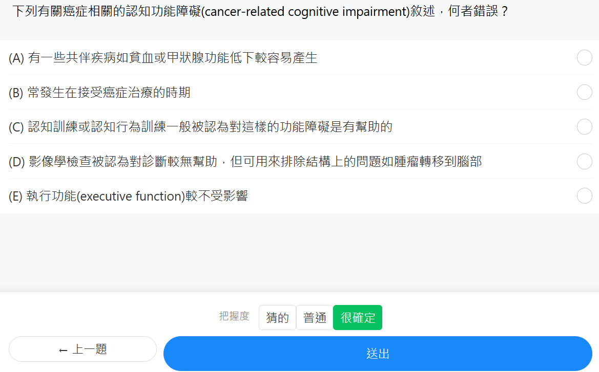

語言 Language： **繁體中文** ｜ [English](README.en.md)

# exam-practice · 專科考試練習平台

> 一套以 **FSRS 間隔重複** 為核心的考題練習系統。最初是我為了準備**復健科 (PMR, Physical Medicine & Rehabilitation) 專科考試**、給院內醫師與自己練習而打造的 side project，現在整理成原始碼公開、可自架、也適用於其他專科考試的版本（非商業免費，詳見[授權](#授權)）。

🔗 **線上 Demo**：<https://exam-demo.drpwchen.com>（內建示範帳號，開啟即可試用）



---

## 畫面截圖

| | |
|---|---|
|  |  |
|  |  |
|  |  |
|  |  |

---

## 這是什麼

準備專科筆試時，最有效的方式之一是反覆練歷屆考題、並針對「會錯的」加強複習。單純看著題目考自己滿容易疲倦的，於是我自己做了一套：

- 匯入 **PDF考題** 就轉換成可練習的題庫
- 用 **FSRS (Free Spaced Repetition Scheduler)** 依作答記憶曲線排定每題的下次出現時間，確保記熟每一題
- 與科內住院醫師一起練習，可看到**同儕進度、大家的常錯題**
- 依個人在各科表現、複習狀況，**預測考試當天的落點分數**

> 這是一人維護的 side project，歡迎 fork 改成你自己專科的版本。

## 核心功能

### 1 · 題目輸入（PDF → 題庫）
歷屆考題多半是 PDF。本專案內建一條匯入管線：

```
PDF ──► PyMuPDF 取文字 + 影像 ──► 自動裁切去白邊 ──► parser 切題/選項/答案
    ──► 依 source_ref 冪等 upsert 進 DB ──► 規則式 sanity-check ──► admin 後台人工校對
```

- 文字讀取易誤判，**詳解直接以「該頁截圖」呈現**，避免 OCR 誤植選項或答案。
- 圖片題（X 光、超音波、量表）會抽出並裁切，附在題幹或詳解。
- admin 後台可逐題修訂，所有修改留 revision 歷史。

### 2 · 練習引擎（FSRS 三池排程）
- 每次作答記錄 **正確與否、信心度、作答時間**，轉成 FSRS rating 更新該題記憶狀態。
- 出題採三池策略：**到期複習題 (70%) + 新題 (20%) + 星號題 (10%)**，並依「快要忘記但救得回來」的甜蜜點排序。
- 練習模式：智慧排程／衝刺新題／複習舊題 (到期題目/錯題本/星號題)／**大家的錯題本**／隨機。
- 選項每次**隨機洗牌**（種子可還原），降低背答案位置的作弊空間。

### 3 · 個人與大家的錯題本
- **個人錯題本**：自動收錄答錯的題，依**失敗型態**自動分類——**死穴**（反覆 lapse）／**易忘**（記憶留存率已偏低）／**盲區**（把握十足卻答錯＝過度自信）／**新錯**（最近一次答錯）；可只挑某一種弱點來練，並加星、寫心得、調出題頻率。
- **大家的錯題本**：彙整全體最常錯的題（依初答／再答錯誤率分難度等級），看見共同弱點、一起補強。

### 4 · 分數預測
- 依**各次專科的正確率 × 該科在真實考試的配分權重 × FSRS 推估的檢定日記憶留存率**，估算總分落點（含 Wilson 95% 信賴區間、「持續複習 vs 不複習」兩情境）。
- 模型把每科拆成**初答正確率**（沒看過的新題實力）與**二刷後正確率**（複習到位後的命中率）；複習情境是**逐題用 FSRS 模擬複習到考前**算出考試當天的記憶率，而非套用固定常數。
- 💡 **要預測準，請從第一次接觸考題就用本系統練**——「初答正確率」是估「新題實力」的關鍵；若那些題你已在別處做過，這裡的初答會虛高、預測就會偏樂觀。

## Demo 題庫與授權聲明

為了讓任何人 clone 後立刻看到完整功能，本專案附了一份**示範題庫**：

- **20 題真實的復健科歷屆考題**（114 年）題幹與選項，屬已公開之考選資源。
- 這 20 題的**詳解由Claude撰寫**，並標注教科書出處（Braddom／DeLisa 等），僅為示範用，詳解內容可能有誤。
- 部分題目為 AI 生成，用於展示圖片題與複選題功能，非復健科真實考題。
- **所有使用者與作答記錄皆為程式合成**，不對應任何真實考生。

## 技術棧

| 層 | 技術 |
|---|---|
| 後端 | FastAPI · SQLAlchemy 2.0 · SQLite (WAL) · JWT 驗證 · FSRS-6 |
| 前端 | Vue 3 (Composition API) · Vant 4 · Vite · Pinia · PWA |
| 題庫管線 | PyMuPDF (fitz) · Pillow · 規則式 parser |

## 快速開始

需求：Python 3.11+、Node 18+。

```bash
# 1. 後端
python -m venv .venv && source .venv/bin/activate   # Windows: .venv\Scripts\activate
pip install -r requirements.txt
cp env.example .env             # 編輯 SECRET_KEY、ADMIN_USERNAME 等
python -m pipeline.seed_demo    # 建立示範資料庫（20 題 + 合成使用者作答）
uvicorn backend.main:app --reload

# 2. 前端（另開終端）
cd frontend
npm install
npm run dev                     # 開 http://localhost:5173
```

預設示範帳號會在 `seed_demo` 輸出中列出，登入後即可練習、看儀表板、錯題本與分數預測。

## 匯入你自己的題庫

1. 把歷屆 PDF 放進 `PAST_PAPER_DIR`（於 `.env` 設定）。
2. 跑匯入管線（細節見 [`docs/IMPORT_PROCEDURE.md`](docs/IMPORT_PROCEDURE.md)）。
3. 用 `python -m tools.sanity_check` 檢查解析品質，再到 admin 後台校對。
4. 想換成別的專科：題庫、次專科分類（`seeds/`）換成你的即可，引擎與排程不需改動。

> 📋 **開始前的完整設定清單**（考試日期、專科分類、題目標記方法…）與**和 LLM 協作整理題庫的 prompt 範本** → [SETUP.md](SETUP.md)

## ⚠️ 自架上線前的安全提醒

這是一套**多人、會儲存個人作答資料**的系統。公開上線前請務必：

- **更換 `SECRET_KEY`** 為高強度隨機字串（切勿沿用範例值）。
- 每位使用者設簡單預設密碼後，開啟**首次登入強制改密**。
- 一律走 **HTTPS**（建議放在反向代理／Cloudflare Tunnel 後）。
- 保留內建的 **rate limiting**，保護登入端點。
- **切勿**把 `.env`、正式 `data/*.db` commit 進版控（已列入 `.gitignore`）。
- 定期**備份資料庫**，並限制 admin 帳號權限。

## 授權

本專案採 **[PolyForm Noncommercial License 1.0.0](LICENSE)**（原始碼公開的 source-available 授權）：

- **非商業使用免費**：個人讀書、同儕共學、學校／醫院等非營利機構之教學與研究，皆可自由 clone、自架、修改、fork。歡迎拿去改成你自己專科的版本。
- **商業使用需授權**：補習班、營利培訓、付費平台等以營利為主要目的之利用，請先取得商業授權 → 📧 **contact@drpwchen.com**

內含的 FSRS 等第三方元件保有其原始授權（MIT），詳見 [THIRD-PARTY-LICENSES.md](THIRD-PARTY-LICENSES.md)。

---

*Built by 陳柏威 — 復健科醫師。如果這個工具對你準備專科考試有幫助，歡迎 star ⭐。*

## 🧋 支持

如果這個工具幫你省下時間，歡迎請我喝杯飲料，讓伺服器繼續轉下去 🧡

[](https://drpwchen.com/support/)

---

## 🌱 Start here if you're new to AI agents ／ AI agent 新手起點

This tool is one piece of my personal AI workflow. If you want to learn how to use AI agents like Claude Code from zero (no programming background needed), I wrote a beginner series (in Traditional Chinese):

這個工具是我個人 AI 工作流的一部分。想從零開始學怎麼用 Claude Code 這類 AI agent（不需要程式背景），可以從我的入門系列開始：

1. [從零開始：安裝、看懂 GitHub、跑起你的第一個工具](https://drpwchen.com/posts/getting-started/)
2. [怎麼跟 AI agent 講話：心法、元技能與規則檔](https://drpwchen.com/posts/talking-to-agents/)
3. [自動化流程不是設計出來的，是長出來的](https://drpwchen.com/posts/growing-your-workflow/)

Full map of my tools and posts ／ 所有工具與文章的全貌 → [drpwchen.com/map](https://drpwchen.com/map/)
